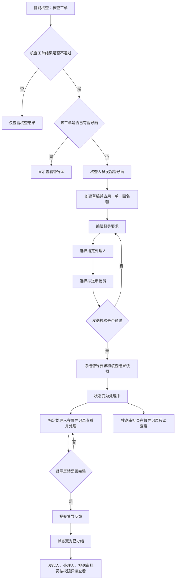

# 智能核查督导函统一管理设计

## 1. 需求概述

### 1.1 目标

将督导函从“子单管理”迁移到“智能核查”，由智能核查模块统一发起、发送、查看、处理和留痕，消除当前智能核查与子单流程同时维护督导函所造成的状态、权限和示例数据冲突。

### 1.2 范围

- 在“智能核查 > 核查工单”中，对“核查工单结果 = 不通过”的工单发起督导函。
- 在“智能核查 > 督导记录”中展示、编辑草稿、发送、查看和处理督导函。
- 督导函绑定一名指定处理人，不进入机构池，不支持领取或转派。
- 督导函可抄送一名或多名审批员；被抄送审批员在智能核查页面只读查看。
- 督导函状态统一为“草稿、处理中、已办结”。
- 同一工单最多存在一笔督导函。
- 将“补充内容”统一改为“督导要求”；发送前可编辑，发送后只读。
- 督导函中的智能核查结果沿用主单详情的展示结构和样式。
- 删除子单模块中的督导函定义、入口、工单池、工作台、审批和演示记录。
- 增加覆盖三种状态和不同角色视角的督导函示例数据。

### 1.3 不在本次范围

- 不接入真实消息、短信、邮件或后端接口。
- 不新增督导函审批流程；抄送审批员不等于发起审批。
- 不新增领取、转派、退回、撤销、废止或删除状态。
- 不改变其他子流程的字段、状态和权限。
- 不改变智能核查算法及“核查工单结果”的生成规则。

## 2. 关键业务规则

### 2.1 发起条件

1. 仅“核查工单结果 = 不通过”的工单显示“发起督导函”。
2. 一笔工单只能发起一笔督导函，唯一键为关联工单编号 `ticketId`。
3. 唯一性覆盖全部状态：草稿、处理中和已办结均占用名额。
4. 已存在督导函时，核查工单列表不再显示“发起督导函”，改为“查看督导函”。
5. 草稿不提供删除操作，避免通过删除后重复发起绕过“一单一函”。

### 2.2 角色与权限

| 角色 | 草稿 | 处理中 | 已办结 |
| --- | --- | --- | --- |
| 发起人/核查人员 | 创建、编辑督导要求、选择指定处理人和抄送审批员、发送 | 只读查看 | 只读查看 |
| 指定处理人 | 不可见 | 查看督导函、编辑督导反馈、提交办结 | 只读查看 |
| 被抄送审批员 | 不可见 | 只读查看 | 只读查看 |
| 其他人员 | 无权限 | 无权限 | 无权限 |
| 开发测试视图 | 可按角色切换验证全部场景 | 可按角色切换验证全部场景 | 可按角色切换验证全部场景 |

权限判断以人员标识为准，不以机构池或角色池为准。指定处理人不能领取，因为发送时已经完成绑定。

### 2.3 状态流转

| 当前状态 | 操作 | 操作人 | 下一状态 | 说明 |
| --- | --- | --- | --- | --- |
| 无记录 | 发起督导函 | 核查人员 | 草稿 | 创建后立即占用该工单唯一督导函名额 |
| 草稿 | 保存草稿 | 发起人 | 草稿 | 可修改督导要求、指定处理人和抄送审批员 |
| 草稿 | 发送督导函 | 发起人 | 处理中 | 发送后锁定督导要求和核查结果快照 |
| 处理中 | 提交督导反馈 | 指定处理人 | 已办结 | 督导反馈必填，提交后只读 |

不允许“草稿 → 待处理”，也不存在“待处理 → 领取 → 处理中”。

### 2.4 督导要求和核查结果

- 字段名称统一为“督导要求”。
- 草稿状态下，发起人可编辑督导要求。
- 发送后，督导要求在处理人和审批员视角均为只读。
- 草稿编辑页展示关联主单的最新智能核查结果。
- 发送时保存一份智能核查结果快照，用于审计和后续查看；主单核查结果后续变化不覆盖已发送督导函。
- 核查结果的分组、标签、颜色、判断原因和空状态复用主单详情智能核查组件或同一渲染函数，不再维护督导函专用的第二套样式。

## 3. 过程模型

### 3.1 参与者

- 核查人员：查看不通过工单、创建草稿、编辑并发送督导函。
- 指定处理人：处理本人收到的督导函并提交反馈。
- 抄送审批员：在智能核查页面查看已发送督导函，不参与流转。
- 原型运行时：校验发起条件和唯一性，保存状态、快照和流转记录。

### 3.2 输入与输出

输入包括关联工单、核查结果、督导要求、指定处理人、抄送审批员和督导反馈。输出包括督导函记录、状态、核查结果快照、发送记录、办结记录及面向不同角色的列表。

### 3.3 流程



## 4. 页面与交互设计

### 4.1 核查工单页签

- 保留工单筛选、查看核查结果和详情能力。
- “核查工单结果 = 不通过”且无督导函：显示“发起督导函”。
- 已有督导函：显示“查看督导函”，并显示当前督导函状态。
- 通过、未生成或生成失败的核查结果不允许发起督导函。
- 重复点击或并发模拟导致重复发起时，运行时再次按 `ticketId` 校验并提示“该工单已存在督导函”。

### 4.2 督导记录页签

按当前登录视角过滤：

- 发起人看到本人创建的草稿及本人发送的记录。
- 指定处理人看到绑定给本人的处理中和已办结记录。
- 抄送审批员看到抄送给本人的处理中和已办结记录。
- 同一人员具备多种关系时只显示一条记录。

建议列表字段：督导函编号、关联工单、客户姓名、指定处理人、抄送审批员、状态、创建/发送时间、操作。草稿操作为“编辑”，处理中和已办结操作为“查看”；只有指定处理人在处理中看到“处理”。

### 4.3 草稿编辑页

- 只读：关联工单、客户信息、核查结果。
- 可编辑：督导要求、指定处理人、抄送审批员。
- 操作：保存草稿、发送督导函。
- 发送校验：指定处理人必选；督导要求必填；核查结果仍为不通过；除当前草稿外，该工单不存在其他督导函。

### 4.4 处理与详情页

- 基本信息中展示发起人、指定处理人、抄送审批员、关联工单、状态和时间。
- “督导要求”发送后统一只读。
- “智能核查结果”使用主单样式并展示发送时快照。
- 指定处理人在处理中可填写“督导反馈”；其他人只读。
- 提交督导反馈后状态变为已办结，反馈和办结时间只读。
- 流转记录仅包含：创建草稿、保存草稿（可合并为最近更新时间）、发送督导函、提交督导反馈；不得出现领取记录。

## 5. 数据与模块边界

### 5.1 唯一数据源

督导函运行时记录由 `src/modules/complaints/inspections/` 单独拥有。该模块负责列表、详情、权限、状态流转、样例数据和本地存储兼容。

建议记录结构至少包含：

```text
id, ticketId, status,
senderId, senderName, senderOrg, senderDepartment,
receiverId, receiverName, receiverOrg, receiverDepartment,
ccApproverIds, ccApproverNames,
supervisionRequirement,
inspectionResultSnapshot,
feedback, createdAt, updatedAt, sentAt, completedAt
```

人员判断使用稳定的人员标识；显示名称仅用于页面展示。`ccApproverIds` 使用数组，避免将多人抄送存成不可判断权限的拼接文本。

### 5.2 清理子单双重归属

需要从以下范围移除督导函：

- 子单创建类型和字段配置。
- 子单状态机、审批规则和权限规则。
- 子单机构工单池、我的工作台和审批管理列表。
- 主单“关联子流程”和关联单据中的督导函子单记录。
- 子单演示数据、编号生成、领取和处理事件。
- `app.js` 中遗留的督导函子单兼容分支。

其他子流程不受影响。新增功能应留在智能核查模块，不继续向 `app.js` 增加业务责任。

### 5.3 旧数据兼容

- 对旧版本本地存储中的督导函子单执行一次兼容读取和迁移。
- 可明确映射的记录转为智能核查督导函；旧“待处理”映射为“处理中”，并保留原接收处理人。
- 无法确认关联工单或指定处理人的旧记录不进入可操作列表，显示迁移提示并保留原始数据，不静默删除。
- 迁移完成后写入版本标识，避免每次打开重复迁移。
- 新版本不再向子单存储写入督导函。

## 6. 示例数据

至少补充以下演示记录：

1. 草稿：由当前核查人员创建，已填写督导要求，尚未发送。
2. 处理中：绑定当前处理员，抄送当前审批员，可验证处理与只读查看差异。
3. 已办结：包含督导要求、核查结果快照、督导反馈和完整流转记录。
4. 一笔核查不通过但尚未发函的工单，用于验证发起入口。
5. 一笔已有督导函的核查不通过工单，用于验证“一单一函”和“查看督导函”。

示例数据必须使用虚构信息，不包含真实客户数据。

## 7. 异常处理

- 核查结果不是“不通过”：阻止发起并提示业务原因。
- 已存在督导函：阻止重复创建并跳转已有记录。
- 指定处理人为空或督导要求为空：发送前字段级提示，不改变草稿状态。
- 非指定处理人尝试提交反馈：拒绝操作并保持原状态。
- 抄送审批员尝试编辑：控件保持只读，事件层再次拒绝。
- 重复提交反馈：已办结记录不再提供提交按钮，事件层保持幂等。
- 本地存储损坏：回退到演示数据并提示，不影响其他模块打开。

## 8. 测试策略

### 8.1 数据与状态测试

- 状态集合严格等于草稿、处理中、已办结。
- 不存在待处理、领取、转派和审批动作。
- 一单一函唯一性覆盖三个状态。
- 草稿发送后锁定督导要求和核查结果快照。
- 只有指定处理人可以提交督导反馈。
- 抄送审批员可以查看但不能编辑。
- 旧“待处理”督导函正确迁移为“处理中”。

### 8.2 页面与角色测试

- 核查结果通过时无发起入口，不通过时按是否已有督导函显示发起或查看。
- 发起人、指定处理人、抄送审批员及无关人员的列表和操作符合权限矩阵。
- 督导函智能核查结果与主单详情样式一致。
- 督导要求在草稿可编辑，发送后只读。
- 子单创建、处理、审批、关联子流程和关联单据中均不再出现督导函。
- 多条示例数据在对应角色下可访问。

### 8.3 回归与部署测试

- 保留 `file://` 直接打开方式。
- 运行 `npm run check:syntax`、`npm run test:data`、`npm run test:ui` 和 `npm run verify`。
- 若修改结构化数据源，运行 `npm run build` 和 `npm run check:generated`，检查源文件与生成文件一致。
- 回归其他子流程的创建、领取、处理、审批和关联展示，确保移除督导函不会改变其行为。

## 9. 验收标准

1. 智能核查是督导函唯一业务入口，子单模块不再出现督导函。
2. 仅核查结果不通过且未发函的工单可以发起督导函。
3. 同一工单无法创建第二笔督导函。
4. 督导函发送时已绑定指定处理人，不出现待处理或领取操作。
5. 状态只显示草稿、处理中、已办结，并按设计流转。
6. 发起人可在草稿编辑督导要求；发送后所有角色均只读。
7. 只有指定处理人可在处理中填写督导反馈并办结。
8. 被抄送审批员可在智能核查页面查看处理中和已办结督导函，不能编辑或审批。
9. 督导函中的智能核查结果与主单展示一致，并在发送后保持快照。
10. 督导记录包含多种状态的演示数据，角色权限和操作均可演示。
11. 旧督导函子单数据不会被静默删除，可迁移的数据按规则迁移。
12. 自动测试、生成文件检查及 `file://` 回归通过，或在 PR 中准确记录无法执行的环境原因。

## 10. 已确认决策与实现假设

### 已确认决策

- 督导函统一在智能核查模块发送、查看和处理。
- 督导函绑定指定处理人，不能领取。
- 审批员仅作为抄送人查看，不参与审批。
- 状态仅为草稿、处理中、已办结。
- 一笔工单只能发起一笔督导函。
- 督导要求发送前可编辑，发送后只读。

### 实现假设

- “一笔工单只能发起一笔督导函”包括草稿；草稿不提供删除功能。
- 抄送审批员在督导函发送后才可见，草稿仅发起人可见。
- 发送时冻结智能核查结果快照，以保证已发督导函的审计一致性。
- 处理阶段不允许更换指定处理人；如未来需要改派，应作为独立业务需求设计。
